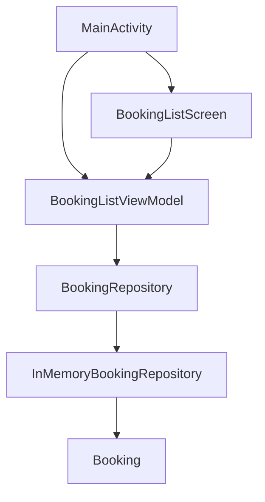

# android-architecture-blueprint

A small Kotlin booking list that shows a module split, a repository boundary, and a lifecycle-aware Compose screen. The data shown at runtime is in memory. Networking is intentionally not in this repository.

## What is implemented

- `:core:model`, `:core:data`, `:feature:bookings`, and `:app`.
- Coroutines and `StateFlow` on `viewModelScope`.
- `collectAsStateWithLifecycle` in the activity.
- Constructor-injected repository. No DI framework.
- JVM tests for the repository. Android unit tests for success, failure, and cancellation when the `ViewModelStore` is cleared.
- Gradle Kotlin DSL and a version catalog.

## Versions

Checked against Maven metadata and the Android Gradle Plugin 9.4 release notes on 23 October 2026. The machine this was built on has JDK 17, Android SDK platforms 37.0 and 37.2, and build-tools 36.0.0.

- Android Gradle Plugin 9.4.1, which brings its own Kotlin support. The `org.jetbrains.kotlin.android` plugin is not applied.
- Gradle 9.6.0
- Kotlin 2.4.21, including the Compose compiler plugin
- Coroutines 1.11.0
- Compose BOM 2026.09.00
- Activity Compose 1.13.0
- Lifecycle 2.11.0
- `compileSdk` 37, `targetSdk` 36, `minSdk` 26. Compose BOM 2026.09.00 requires API 37 at compile time. SDK platforms 37.0 and 37.2 were installed locally for that check. The app still targets 36.

## Architecture



Decisions are in [docs/adr](docs/adr).

## Build

```bash
./gradlew test lintDebug assembleDebug
```

`local.properties` is gitignored. Point `sdk.dir` at an Android SDK, or set `ANDROID_HOME`.

## Limitations

- No network, persistence, or authentication.
- One screen. There is no navigation graph.
- Copy in the Compose screen is English only.
- CI is in `.github/workflows/ci.yml`. This README has no status badge until that workflow has passed on GitHub.

## License

[MIT](LICENSE)
